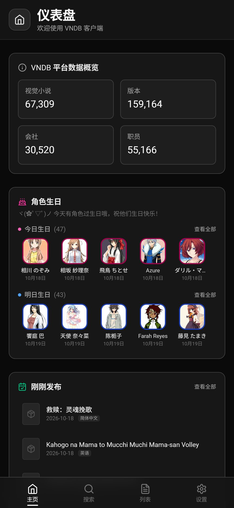
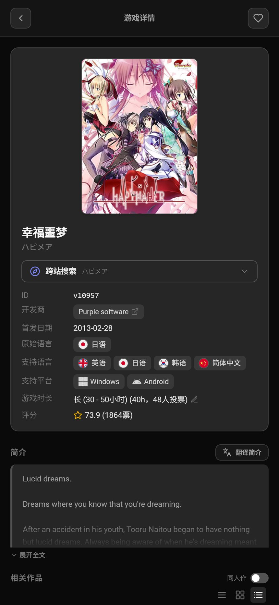
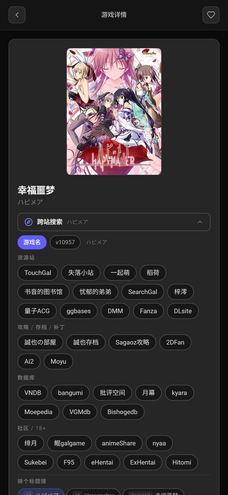
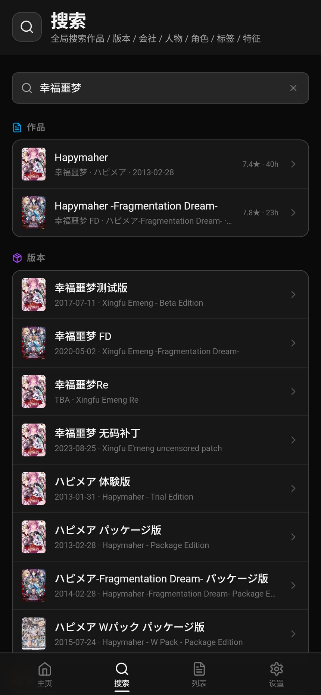
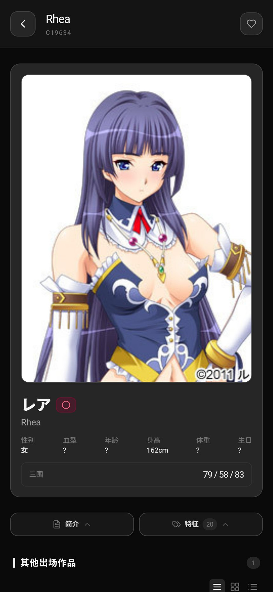
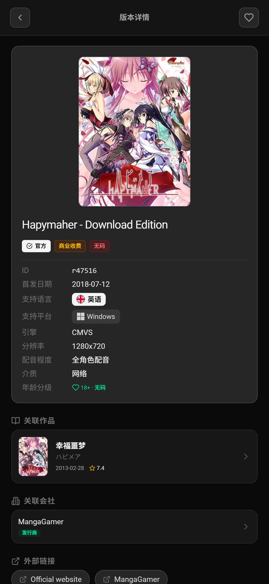
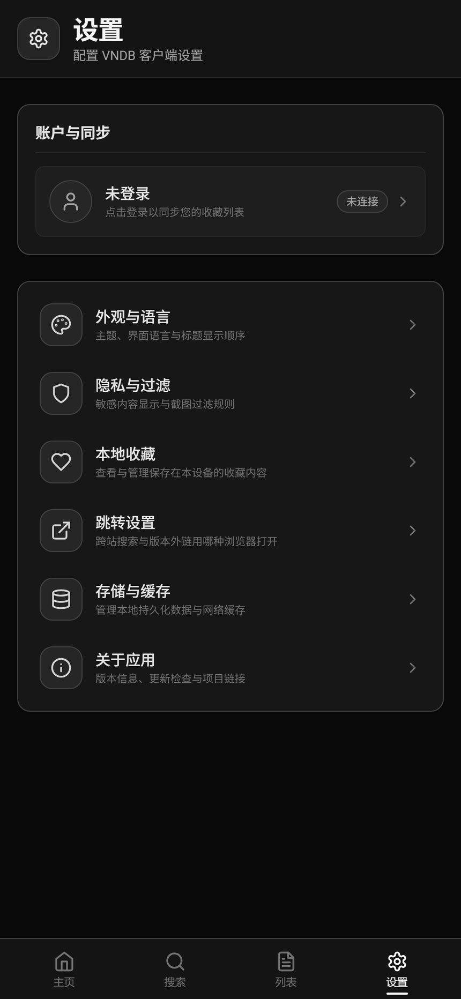

# VNDBest

[](https://github.com/isTurn/vndbest/actions/workflows/release.yml)
[](https://github.com/isTurn/vndbest/releases)
[](https://www.android.com/)
[](https://vuejs.org/)
[](https://capacitorjs.com/)
[](#许可证)

VNDB（Visual Novel Database）的 Android 第三方客户端。基于 **Vue 3 + Vite + Ionic Vue + Capacitor** 构建，针对手机端浏览体验做了大量优化，并集成了跨站搜索、站内中文化、登录态持久化等增强功能。

> 本项目 fork 自 [Cyancat000/vndbest](https://github.com/Cyancat000/vndbest)，由 [isTurn](https://github.com/isTurn) 与 [Hatsube01](https://github.com/Hatsube01) 继续完善与发布。

---

## 截图

| 仪表盘 | 作品详情 | 跨站搜索 |
| --- | --- | --- |
|  |  |  |

| 全局搜索 | 角色详情 | 版本详情 | 设置 |
| --- | --- | --- | --- |
|  |  |  |  |

---

## 功能

### 数据浏览

- **作品（VN）**：封面、简介、标签、角色、职员、版本、评分分布、游玩时长
- **角色**：立绘、特征、出演作品、生日、三围
- **会社 / 职员**：作品列表、参与角色
- **版本（Release）**：发售日期、平台、语言、引擎、分辨率、外部链接
- 六个维度的搜索页（作品 / 版本 / 角色 / 职员 / 会社 / 标签），支持标签与特征的多级筛选、剧透等级过滤、性内容过滤
- **已保存搜索**：把常用筛选条件存下来，在仪表盘一键复用

### 全局搜索

在「搜索」页输入任意关键词（**支持中文作品名**），一次并发查询多个分类：

| 分组 | 说明 |
| --- | --- |
| 作品 | 命中 VN 本体，带评分与时长 |
| 版本 | 该作品的各平台发行版本 |
| 会社 | 开发商 / 发行商 |
| 角色 | 该作品的角色（与直接命中的角色合并去重） |
| 职员 | 该作品的制作人员（与直接命中的职员合并去重） |
| 标签 / 特征 | 直接命中时出现 |

中文名搜索通过「先用 `search` 命中 VN，再用 VN id 反查角色 / 职员」两层查询实现，因此「幸福噩梦」这类中文译名也能定位到 `v10957` 及其会社 `Purple software`。

### 跨站搜索

作品详情页内置 **36 个** Galgame 相关站点的跨站搜索，分四组：

| 分组 | 站点 |
| --- | --- |
| **资源站**（13） | TouchGal、失落小站、一起萌、稻荷、书音的图书馆、忧郁的弟弟、SearchGal、梓澪、量子ACG、ggbases、DMM、Fanza、DLsite |
| **攻略 / 存档 / 补丁**（6） | 誠也の部屋、誠也存档、Sagaoz攻略、2DFan、Ai2、Moyu |
| **数据库**（8） | VNDB、bangumi、批评空间、月幕、kyara、Moepedia、VGMdb、Bishogedb |
| **社区 / 18+**（9） | 绯月、鲲galgame、animeShare、nyaa、Sukebei、F95、eHentai、ExHentai、Hitomi |

支持两种搜索模式：**按标题搜**（自动挑选最合适的标题，含别名 / 罗马音 / 中译）与**按 VN 编号搜**。TouchGal 在「内置浏览器」模式下会自动填入关键词并触发搜索。

### 内置浏览器

基于 [`@capgo/inappbrowser`](https://github.com/Cap-go/capacitor-inappbrowser) 的内嵌 WebView：

- **登录态持久化**：`CookieKeeper` 原生插件为每个会话 Cookie 补上 `Max-Age`（一年）并主动 `flush()`，避免 WebView 关闭后登录失效
- **VNDB 中文化**：内置「VNDB优先原文和中文化」脚本（v5.0.1 + VNDBTranslatorLib v5.0.0），打开 vndb.org 时自动注入，界面与标签按中文显示。可在「设置 → 外观」里关闭
- **首屏加载失败自动重试**：偶发网络抖动导致 WebView 白屏时会重试一次，不再直接甩去系统浏览器

### 其他

- **中 / 英 / 日** 三语言界面，VN 标签与角色特征均有中文化词典（**6000+ 条**：标签 3088 + 特征 3237）
- **深浅色主题**、可自定义背景图、可自定义标题显示顺序（原文 / 罗马音 / 中译）
- **隐私与过滤**：18+ 内容、截图过滤、剧透等级
- **本地收藏**与 VNDB 账号同步（API Token 登录）
- **游玩时长投票**：本地弹窗填写，直接同步到 VNDB
- **图片加载优化**：缩略图优先 + 6 并发预热队列 + 缩略图 404 自动回退原图 + 15s 超时兜底
- **搜索历史**：「搜索」页记住最近 20 条关键词，可单条删除或一键清空
- **版本封面回退**：release 自己没有封面时（免费 / 补丁 / 同人作品），自动改用关联作品的封面，不再只显示占位图标
- **跳转设置**：跨站搜索与版本外链的浏览器打开方式分别配置
- **离线提示**、返回键双击退出、错误态与重试

---

## 下载

从 [Releases](https://github.com/isTurn/vndbest/releases) 下载最新的 APK 安装。

- 要求 Android 7.0（API 24）及以上
- 包名 `com.vndb`
- release 包已开启 R8 混淆与资源裁剪，体积约 **3 MB**

> **从旧版升级**：1.0.3 之前的版本包名是 `com.cyancat.vndbest`，与当前包名不同，需要先卸载旧版再安装。

---

## 开发

```bash
npm install
npm run dev
```

开发服务器会代理 `/api/vndb` 到 `https://api.vndb.org/kana`，用于绕过浏览器 CORS 限制（PATCH / DELETE 请求需要）。

### 构建 Web 产物

```bash
npm run build
```

### 同步并构建 Android

```bash
npx cap sync android
cd android && ./gradlew assembleDebug
```

产物位于 `android/app/build/outputs/apk/debug/app-debug.apk`。

> **注意**：`npx cap sync android` 不可省略。它会生成 `capacitor.plugins.json` 并注册原生插件（`CookieKeeper`、`InAppBrowser`），手工拷贝 `dist/` 到 `android/app/src/main/assets/public/` 会导致插件未注册、相关功能失效。

### 构建 release 包

```bash
npm run build
npx cap sync android
cd android && ./gradlew assembleRelease
```

release 变体开启了 `minifyEnabled` + `shrinkResources`，依赖 `android/app/proguard-rules.pro` 里的 Capacitor 反射 keep 规则。**修改插件的反射用法后务必回归测试**，否则 R8 可能裁掉运行时才用到的类。

### iOS

```bash
npx cap sync ios
npx cap open ios
```

需要 macOS + Xcode。

---

## 项目结构

```
src/
├── api/vndb.js              VNDB Kana API 封装（超时、429 限流、错误映射）
├── components/              可复用组件（列表、筛选面板、骨架屏、错误态、年龄标识…）
├── composables/             组合式函数（主题、隐私、收藏、图片加载、剪贴板、已保存搜索…）
├── i18n/locales/            中 / 英 / 日 语言包 + 标签与特征词典
├── icons/                   Iconify 图标注册与名称映射
├── pages/                   页面（仪表盘、搜索、详情、设置…）
├── router/                  路由（hash 模式）
└── utils/
    ├── crossSearch.js       跨站搜索站点表与链接构造
    ├── linkOpener.js        外链打开策略（内置 / 系统浏览器 + 全局拦截）
    ├── touchgalSearch.js    TouchGal 自动填词注入脚本
    ├── vndbTranslator.js    中文化脚本注入
    ├── imagePrefetch.js     图片预热队列
    ├── lengthVote.js        游玩时长投票
    ├── cookieKeeper.js      登录态持久化
    ├── errorMessage.js      API 错误消息本地化
    └── ulistLabels.js       收藏标签本地化
scripts/
├── build-vndb-translator.cjs   生成 public/vndb-translator.js
└── vendor/                     第三方脚本固化（VNDBTranslatorLib）
android/                        Capacitor Android 工程
docs/
├── vndb-api-kana.md            VNDB Kana API 中文参考
└── screenshots/                README 截图
```

---

## CI / 发布

推送到 `v*` 标签会触发 GitHub Actions 构建 Release APK 并创建 GitHub Release：

```bash
git tag v1.0.4
git push origin v1.0.4
```

也可以在 Actions 页面手动 `workflow_dispatch`，指定版本号（留空则取 `package.json` 的 version）。

流水线会：

1. 安装依赖（Node 22 + JDK 21）、构建 Web 产物
2. 重新生成中文化脚本（`public/vndb-translator.js`）
3. `npx cap sync android` 注册原生插件并校验插件清单
4. 构建 APK（release 变体）
5. 上传为 Action artifact；打 tag 时额外创建 GitHub Release

---

## 签名配置

项目随仓库携带一个**固定的 debug keystore**（`android/app/debug.keystore`，口令 `android`，别名 `androiddebugkey`），`android/app/build.gradle` 里显式指定它给 `debug` signingConfig。release 变体默认就用这个签名，因此：

- 本地 `./gradlew assembleRelease` 与 GitHub Actions 产出的 APK **签名完全一致**，可以互相覆盖安装；
- 不再依赖 `$ANDROID_USER_HOME/.android/debug.keystore`（这个文件每台机器、每次 CI 都会重新生成，导致签名各不相同、本地包与发布包无法互相升级）。

如需换成正式签名，在仓库 Settings → Secrets 里配置下面四项，CI 会优先使用它（本地也可用同名环境变量）：

| Secret | 说明 |
| --- | --- |
| `ANDROID_KEYSTORE_BASE64` | keystore 文件的 base64（`base64 -w0 my.keystore`） |
| `ANDROID_KEYSTORE_PASSWORD` | keystore 密码 |
| `ANDROID_KEY_ALIAS` | 密钥别名 |
| `ANDROID_KEY_PASSWORD` | 密钥密码 |

未配置时自动回退到内置 debug keystore。本地构建时若不想用正式签名，注意不要设置 `ANDROID_KEYSTORE_PATH` 环境变量。

> 证书指纹（内置 debug keystore，SHA-256）：`D4:A2:28:CA:12:C8:0B:14:86:07:80:CC:8A:E5:8E:E8:2C:4F:F9:0D:85:18:9D:49:8B:CC:8E:80:D7:4E:F7:6E`

---

## 第三方组件与致谢

本项目使用了以下第三方资源，版权归原作者所有：

| 组件 | 用途 | 来源 |
| --- | --- | --- |
| [VNDB优先原文和中文化](https://greasyfork.org/zh-CN/scripts/442355) v5.0.1 | 在内置浏览器里把 VNDB 页面中文化 | [Greasy Fork #442355](https://greasyfork.org/zh-CN/scripts/442355) |
| [VNDBTranslatorLib](https://greasyfork.org/scripts/445990-vndbtranslatorlib) v5.0.0 | 上者的翻译词典（其 `@require` 依赖） | [Greasy Fork #445990](https://greasyfork.org/scripts/445990) |
| [VNDB跨站搜索](https://greasyfork.org/zh-CN/scripts/600569) v2.5.14 | 跨站搜索站点表来源 | [Greasy Fork #600569](https://greasyfork.org/zh-CN/scripts/600569) |

两个油猴脚本以源码形式固化在仓库中（`scripts/vendor/`、`VNDB优先原文和中文化.js`、`VNDB跨站搜索.js`），由 `scripts/build-vndb-translator.cjs` 拼接成可注入的 IIFE。感谢以上脚本作者的劳动，版权归原作者所有；若原作者有异议，请联系移除。

界面数据来自 [VNDB](https://vndb.org/) 的公开 Kana API。本项目与 VNDB 官方无关。

---

## 免责声明

本项目仅作为 VNDB 的第三方客户端，方便在移动端浏览公开数据。所有内容版权归 VNDB 及其贡献者所有。使用时请遵守 [VNDB 使用条款](https://vndb.org/d17) 与各地法律法规。

---

## 上游

- 原项目：[Cyancat000/vndbest](https://github.com/Cyancat000/vndbest)
- 完善与发布：[isTurn/vndbest](https://github.com/isTurn/vndbest)、[Hatsube01](https://github.com/Hatsube01)

## 许可证

本仓库未声明开源许可证，默认保留所有权利。如需使用代码，请先联系仓库维护者。
